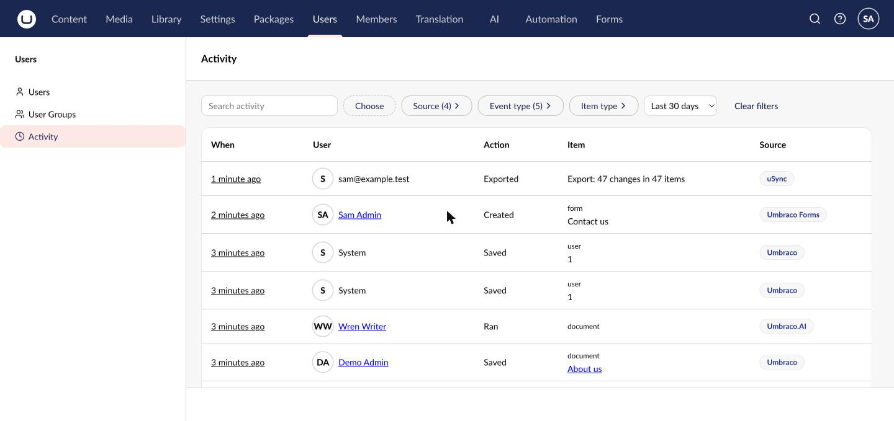
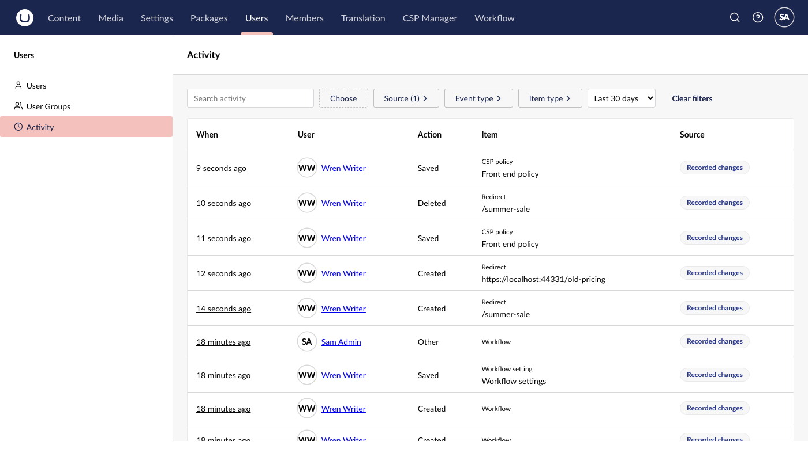

# User Activity

A per-user Activity tab and a global Activity view under Users, reading Umbraco's audit logs and other packages' history.

[](https://github.com/PascalA94/Umbraco.Community.UserActivity/actions/workflows/build.yml)
[](https://www.nuget.org/packages/Umbraco.Community.UserActivity)
[](https://www.nuget.org/packages/Umbraco.Community.UserActivity)
[](https://github.com/PascalA94/Umbraco.Community.UserActivity/blob/main/LICENSE)

A community package, not made or supported by Umbraco HQ. Requires Umbraco 17 (17.8.0 or later) or Umbraco 18 (18.3.0 or later), on .NET 10.



## Compatibility

| Package version | Umbraco |
|---|---|
| 17.x | 17 (17.8.0 or later) |
| 18.x | 18 (18.3.0 or later) |

## Install

```bash
dotnet add package Umbraco.Community.UserActivity
```

If you use any of the recorded packages (CSP Manager, Workflow, Skybrud Redirects, UrlTracker), [set a retention limit](#set-a-retention-limit) before you go live.

## Before you install

This package shows what your staff did in the backoffice. Treat what it shows like an HR record. This section is a starting point for your own checks, not legal advice.

- **Lawful basis.** Under UK GDPR you need a lawful basis to look at staff activity. For most sites it is legitimate interests (Art. 6(1)(f)): keeping a system that holds personal data secure and accountable. Write a short legitimate-interests assessment. You decide this and record it, not the package.
- **Tell your staff.** Your staff privacy notice should say that backoffice activity is recorded and who can see it.
- **Who can see what.**
  - People in the `admin` group who also have the Users section can see every user's Activity tab, their own included, and the global view. Change the groups with `AllowedUserGroups`.
  - These people see every event's item names, whatever their start nodes. Only give this to people you trust with all content.
  - Other users see nothing. With `AllowSelfView` on (off by default), a user who isn't an admin can see their own activity, and only that: from **Your activity** in their profile (select their avatar), or on their own tab if they have the Users section.
  - The tab is hidden from everyone else. The **Activity** menu item shows to anyone with the Users section, but the view answers "not allowed" unless they are a reader. The API checks every request.
- **Watching the watchers.** `LogViews` is on by default. Opening a user's tab, opening the global view for one user or for everyone, opening an event and every export each write a row to Umbraco's audit table, with the viewer and the person viewed. Those rows show on the viewer's own tab. Views are throttled to one row per viewer, person and hour. The throttle is kept per server, so a load-balanced site can write one row per server.
- **Export is off by default.** Switch on `Export:Enabled` only if you need CSV files. A CSV leaves the backoffice, so it is outside these controls.
- **Failed sign-ins.** Umbraco stores what someone typed as a username when a sign-in fails, and people sometimes type a password there. Readers see it in the event details. It is never put in an export.
- **Query strings.** The global view and the Activity tab keep their filters in the URL, so search text and user keys can end up in proxy, CDN and monitoring logs. **Your activity** keeps them in the page only.
- **Erasure and retention.** The package reads other stores and deletes nothing from them. Umbraco, Automate, Forms, Umbraco.AI and uSync keep their rows under their own rules (see [Sources](#sources)). The "viewed" and "exported" rows this package writes go into Umbraco's audit table, which nothing cleans, so they are kept until you remove them. Include them in your retention policy.
  - **The recorder (17.1 / 18.1 and later) is the exception: it keeps a table of its own**, `communityUserActivityEvent`, with the user's key and name at the time of each change, plus item names. It keeps rows forever until you set `Recorder:RetentionDays` (see [Set a retention limit](#set-a-retention-limit)). Deleting a user does not clear their name from it, so a deleted person stays readable. For an erasure request, delete or blank their rows yourself, for example `DELETE FROM communityUserActivityEvent WHERE UserKey = '<the user key>'` or `UPDATE communityUserActivityEvent SET UserName = NULL WHERE UserKey = '<the user key>'`.

## IP addresses

IP addresses are hidden by default (`ShowIpAddresses: false`), in the views, the event details and the export.

The trade-off: when an account may have been compromised, the sign-in IP address is often the most useful fact (a sign-in from a network nobody recognises). Showing every admin every IP address all the time is more than most sites need, so the package leaves it off.

For an investigation:
1. Set `"UserActivity": { "ShowIpAddresses": true }` and restart the site. Only readers (the allowed groups) see IP addresses. Self-view users never do.
2. Look at the sign-in events you need.
3. Set it back to `false` and restart.

Umbraco stores the IP address in its audit table either way. This setting only controls what this package shows.

## Use

- **Global view:** Users section, **Activity** in the menu. Filter by user, source, event type, item type, date range and search. The filters are in the URL, so you can bookmark a view or send the link to another reader.
- **A user's tab:** open a user in the Users section and choose the **Activity** tab. It has the same filters, locked to that user.
- **Your own activity:** select your avatar, then **Open your activity** in the "Your activity" box. It shows to readers, and to everyone when `AllowSelfView` is on.
- Select a row to open its details. All three show the last 30 days by default.

### Settings

Every setting is optional. These are the defaults:

```json
"UserActivity": {
  "AllowedUserGroups": ["admin"],
  "AllowSelfView": false,
  "DefaultRangeDays": 30,
  "MaxRangeDays": 366,
  "MaxDepth": 5000,
  "SourceTimeoutSeconds": 5,
  "ShowIpAddresses": false,
  "LogViews": true,
  "Export": { "Enabled": false, "MaxRows": 10000 },
  "Recorder": { "RetentionDays": 0 },
  "Sources": {
    "Core": { "Enabled": true },
    "Automate": { "Enabled": true },
    "Forms": { "Enabled": true },
    "AI": { "Enabled": true },
    "uSync": { "Enabled": true },
    "ArchivedUsers": { "Enabled": true },
    "Recorder": { "Enabled": true }
  }
}
```

- `AllowedUserGroups` replaces the default, so list `admin` too if you still want it. Group aliases are compared ignoring case. A reader also needs the Users section.
- A bad value stops the site at start-up, with an error naming the setting.
- Source names ignore case (`Sources:AI` and `Sources:ai` are the same). An unknown source name logs one warning at start-up and is otherwise ignored, so you can share settings between sites with different packages installed.

## Sources

A source appears only when its package is installed. There are no licence checks: a package that is installed but unused just has no rows. Switch a source off with `UserActivity:Sources:<Name>:Enabled: false`. Switching off Automate, Forms or Archived Users hides their rows everywhere: the Umbraco source still leaves them out, so they don't show twice when the source is back on.

| Source | Setting name | What it shows | How long its rows are kept |
|---|---|---|---|
| Umbraco | `Core` | Content, media, member, document type, template, language, dictionary and relation changes (`umbracoLog`); users, user groups, members, sign-ins, failed sign-ins, sign-outs, password changes and resets (`umbracoAudit`) | Kept by Umbraco. Umbraco's log scrubber deletes only `open` and `system` log rows older than `Umbraco:CMS:Logging:MaxLogAge` (24 hours by default). Nothing cleans `umbracoAudit` |
| Umbraco Automate | `Automate` | Automation runs that changed CMS data. The person who started a run is the user and the service account is shown as "via". Scheduled and webhook runs show as automation | Kept by Umbraco (`umbracoAudit`) |
| Umbraco Forms | `Forms` | Form create, save and delete, with the real user | Kept by Umbraco (`umbracoLog`) |
| Umbraco.AI | `AI` | Umbraco.AI's audit log: which feature ran, for whom, and whether it worked. Never prompts, responses or error text | Umbraco.AI's own `RetentionDays`, 14 days by default. The view says how long it keeps |
| uSync | `uSync` | Imports and exports from uSync's history (uSync 17.3.0 or later on Umbraco 17) | Files in uSync's temp folder, kept until that folder is cleared (which can happen on a deploy) or the history is cleared from uSync's dashboard |
| Recorder | `Recorder` | Changes in CSP Manager, Workflow, Skybrud Redirects and UrlTracker, which keep no history of their own (see [Recorder](#recorder)) | Kept forever until you set `Recorder:RetentionDays` |
| Archived Users | `ArchivedUsers` | Archive, unarchive, auto-archive, auto-disable, export and purge actions from Umbraco.Community.ArchivedUsers | Kept by Umbraco (`umbracoLog`) |

The item type filter covers content, media, members, document, media and member types, data types, templates, users and user groups. Other Umbraco rows (languages, dictionary items, relation types) show when no item type is chosen.

Forms Audit Trail history isn't shown in this version. Form actions still show through the Forms source.

### What Umbraco doesn't record

The views show what each store recorded, and Umbraco leaves some gaps:
- webhook changes aren't audited;
- stylesheet, script and partial view edits are logged without a file name ("File (name not recorded by Umbraco)");
- some work is logged against the default administrator account, shown with a "Default administrator" tag;
- bulk media deletes are logged against the media root;
- work done outside a backoffice request can show as "System".

### Recorder

CSP Manager, Workflow, Skybrud Redirects and UrlTracker keep no history of who changed what. The recorder fills that gap: it listens to each package's own save and delete notifications and writes one row per change to its own table, `communityUserActivityEvent`. The table is created when the site starts. The recorder source shows only when at least one of those packages is installed, and it is switched off with `UserActivity:Sources:Recorder:Enabled: false` (that also stops recording, but rows already recorded stay until a retention limit removes them).



- **Going forward only.** There is no backfill. Rows start from the day you update to 17.1 / 18.1 (the first versions with the recorder).
- **What a row holds:** when, the user, the kind of change and the item's name. A short list of safe flags is kept for some packages (for example whether a CSP is report-only). It never holds a CSP policy's text, a redirect's destination or query string, or a request body.
- **Which changes:** CSP Manager saves; Skybrud Redirects add, edit and delete; UrlTracker create, update and delete (Umbraco 17 only until UrlTracker ships a stable release for 18); Workflow settings, approval flows (saved or deleted; the flow's contents are not stored), approval groups (created, edited, deleted) and workflow instances (created, each approved step, rejected, completed; cancelled and resubmitted are not recorded).
- **No user.** A change made with no backoffice user (a background job or an API call) is recorded with no user and shows as such.
- **A rolled-back save can still leave a row.** For most packages the recorder writes after the change is stored, so if that package rolls its save back afterwards, a row can remain. It is still a true record that the change was attempted. Skybrud Redirects' delete is the exception: the row is written inside Skybrud's own transaction, so the row and the delete commit or roll back together.
- **Never breaks the other package.** If the recorder can't write, it logs a warning (source and error type only) and the save carries on. Umbraco's own database layer also logs a failed write, and at Debug level that log can include the values being written, so keep Debug logging off on a live site.

### Set a retention limit

`UserActivity:Recorder:RetentionDays` defaults to `0`, which keeps recorder rows **forever**. That default is deliberate: the package never deletes records you haven't chosen to delete (Forms Audit Trail works the same way). But UK GDPR's storage limitation principle says personal data shouldn't be kept longer than you need it, so **set a number of days that matches your retention policy**. 365 is a common choice for security logs.

```json
"UserActivity": { "Recorder": { "RetentionDays": 365 } }
```

A daily background job deletes older rows in batches of 1,000 and logs one line with the count. A negative number stops the site at start-up. While the limit is `0`, the site logs one line at start-up naming the setting, and the source's hint says "Kept forever (no limit set)".

## Limits

- **User matching.** Each source stores users its own way: Umbraco's log by user id, its audit table and Automate by user key, Umbraco.AI by key as text, and uSync by username. A user's tab shows events where they are the user or the "via" account. uSync rows match on the username, so a renamed user's older uSync rows show with the old name and aren't on their tab. If someone new is later given a username that someone else used before, the earlier person's uSync rows show on the new person's tab. Bear this in mind before you act on uSync rows. A deleted user's rows show as "Unknown user" with the name the source kept, if any.
- **Each event shows once.** Automate's, Forms' and Archived Users' rows in Umbraco's tables belong to their own source, so the Umbraco source skips them. Two true rows about one action are both shown: an automation that saves content writes an Automate row for the run and an Umbraco row for the content.
- **Date range.** The views show the last 30 days by default (`DefaultRangeDays`), and a range can be at most 366 days (`MaxRangeDays`).
- **Depth.** You can page back through the newest 5,000 events in a range (`MaxDepth`). Past that, the view asks you to narrow the date range.
- **Totals.** While a search is on, and when a source can't give an exact count (uSync with more than 5,000 history entries, or a third-party source that can't count), the total shows as a minimum, for example "1,000+". You can still page on.
- **Partial results.** A source that fails or takes longer than `SourceTimeoutSeconds` is skipped, and the view names it in a warning. The other sources still show. On SQLite the timeout can't stop a query that is already running.
- **Search** needs 3 to 100 characters. A source that can't search is left out while a search is on, and so is Umbraco.AI (its search would look at error text this package never shows). Umbraco.AI and uSync are also left out while an item type filter is on.
- **Exports** are capped at `Export:MaxRows` rows (10,000), one at a time per user. A failed source stops the export rather than giving you an incomplete file.
- **Recorder history starts when you update.** The recorder keeps nothing from before it was installed, and nothing for a package that is not installed. See [Recorder](#recorder).

## Add your own source

Another package can put its own history on the Activity tab and in the global view. The contract is in this package (namespace `Umbraco.Community.UserActivity.Sources`), so a source only shows up where User Activity is installed. It's small, public and versioned with the package: no breaking changes within a major (17.x, 18.x).

1. Implement `IUserActivitySource`:
   - `Alias`: permanent, `^[a-z][a-zA-Z0-9]{1,31}$`, unique across sources. `core`, `automate`, `forms`, `ai`, `usync`, `archivedUsers`, `formsAuditTrail` and `recorder` are taken.
   - `DisplayNameKey`: a localisation key for the source's name. Without a translation the alias is shown.
   - `IsAvailable`: `false` hides the source everywhere (for example, your feature is switched off).
   - `Info`: the entity types and categories you can return, whether you can count (`CanCount`) and search (`CanSearch`), and how long your store keeps rows (`RetentionHint`). A source that can't search is skipped while a search is active, rather than showing rows that don't match.
   - `QueryAsync`: the top `Limit` events in the date window, newest first (oldest first when `Ascending`), sorted with `ActivityEventOrder`. Apply the user, category, entity type and search filters yourself. Never throw for bad stored data: skip the row.
   - `GetAsync`: one event by your opaque id, with `Details`.
2. Register it from a composer: `builder.UserActivitySources().Append<MySource>();`
3. Your source gets the setting `UserActivity:Sources:<Alias>:Enabled` (on by default) for free.

`samples/SampleSource` is a working source over an imaginary newsletter log, in about 50 lines. Register your own `INewsletterLog` (or whatever your store is) before you try it on a site.

### The event shape

`ActivityEvent` holds the source alias, opaque id (unique within your source), time (UTC), actor (`ActivityActor`: a kind, the user's key or id, the name you stored, and `Via` for an account that acted for someone), category, your raw type, entity, a plain-text summary of up to 500 characters, an IP address (leave it null; it is shown only when `ShowIpAddresses` is on), and `Details` (up to 50 entries of 2,000 characters, shown to readers only).
- Every string is untrusted and shown as plain text, never as HTML.
- A user's tab shows the events where they are the actor or the `Via`. An actor with no user key or id is matched by its stored name against the username (that's how uSync's rows work), so only put a username there, never a display name.
- Never put an IP address in `Details`.

### Claims

If your package writes rows to Umbraco's `umbracoAudit` or `umbracoLog` tables and your source reads them, also implement `IClaimsCoreAuditRows`, so the built-in `core` source skips those rows and each row shows once. You can claim `umbracoAudit` event type prefixes, whole `umbracoLog` entity types, or `umbracoLog` rows by entity type, header and comment prefix. Two sources can't claim the same rows (start-up stops with an error naming both). No source can claim core's own `umbracoAudit` user, user group, member and sign-in rows, or every `umbracoLog` row for users, user groups or members; claim a header and comment prefix instead, as the Archived Users source does.

### What is versioned

- Versioned (stable within a major): the interfaces, `ActivityEvent` and its fields, the category strings, the source aliases and the `Sources:<Alias>:Enabled` settings.
- Not versioned: the `Details` dictionary and `RawType` values. They are free-form, for people to read, and can change in a minor.

## Develop

See `CLAUDE.md` for the commands. In short: `bash build/test.sh` restores, builds and tests both Umbraco lines; run the demo site under `demo/`.

## Licence

MIT. See `LICENSE`. Security issues: see `SECURITY.md`.
