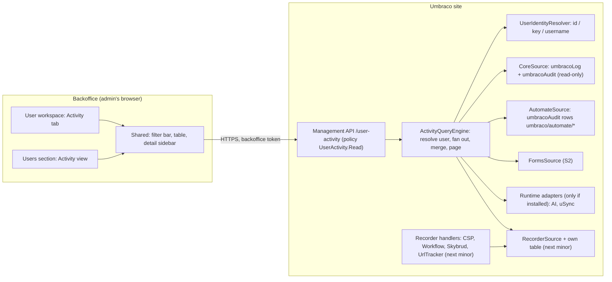

# Design: User Activity

| | |
|---|---|
| Package | `Umbraco.Community.UserActivity` (Pascal, 2026-11-07). **One NuGet package**, no add-ons. ID free on 2026-11-07 [verified: nuget v3-flatcontainer 404]; private repo created |
| Owner | Pascal Meyer (`PascalA94`), personal |
| Size | L-, about **17-21 h** AI time for 0.1 (M0-M4), plus **3-3.5 h** for the recorder in the next minor (M5). See `plan.md` |
| Lines | **Both from the start**: `17.x` on CMS `[17.8.0, 18.0.0)`, `18.x` on `[18.3.0, 19.0.0)`. One codebase, `UmbracoMajor` switch, both packed from one commit |
| Status | Design, 2026-11-07, with Pascal's decisions applied the same day. Nothing built |
| Inputs | the scope notes, the portfolio README, the Umbraco pitfalls reference, the Backoffice Tidy design and the Umbraco.Community.ArchivedUsers repo (house style for the client, Management API and user section), the Forms compliance design (audit-log privacy pattern) |

Tags: **[verified: path]** read this session or in the 2026-11-07 research pass at that path; **[inferred]** reasoned, not run; **[unknown]** nobody has checked, a spike (S1-S7) or Pascal answers it; **[DATED]** true on 2026-11-07 and likely to move.

Evidence was read in a private research pass; its paths are not reproduced here. Untrusted data: read only, never run.

---

## 0. What was verified (2026-11-07)

| Fact | Source |
|---|---|
| Core writes content, media, member, type, template, language, dictionary, relation type and container events to `umbracoLog` through `IAuditService`, keyed by **user id (int)** | CMS 18.3.1 source, research pass [verified]; `src/Umbraco.Core/Services/AuditService.cs` [verified: CMS 18.3 file tree]. 17.8 [inferred] |
| Core writes member, user and user-group changes, logins, failed logins, logouts, password changes and resets to `umbracoAudit` through `IAuditEntryService`, keyed by **`performingUserKey` (Guid)** | same; `src/Umbraco.Core/Services/AuditEntryService.cs` [verified: CMS 18.3 file tree] |
| Table DTOs `LogDto` and `AuditEntryDto` exist in `Umbraco.Infrastructure/Persistence/Dtos` | [verified: CMS 18.3 file tree]. **Internal** on 17.8 and 18.3, so the Core source uses `SqlSyntax`-quoted constants [verified: S5] |
| `IUserIdKeyResolver.GetAsync(int)` and `GetAsync(Guid)` resolve id and key "without fetching the entire user" | [verified: Umbraco.Cms.Core 18.3.0 XML docs] |
| A `LogScrubberJob` exists as a distributed background job | [verified: CMS 18.3 file tree `src/Umbraco.Infrastructure/BackgroundJobs/Jobs/DistributedJobs/LogScrubberJob.cs`]. Every 4 hours it deletes `umbracoLog` rows with `logHeader` `open` or `system` older than `Umbraco:CMS:Logging:MaxLogAge` (default 24 hours); nothing cleans `umbracoAudit` [verified: S5] |
| Core gaps: webhook changes not audited; stylesheet, script and partial view edits logged with object id `-1` and no file name; some paths log a hard-coded super user; bulk media deletes logged against the root; handler-time user can fall back to "system" | CMS 18.3.1 source, research pass [verified] |
| Automate's `AuditTrailMiddleware` writes `umbracoAudit` rows with `performingUserKey` = the **service account** and `eventType` = `umbraco/automate/{alias with '.' replaced by '/'}`; the human is in `eventDetails` as `initiatedBy:"user:<key>"` | [verified: research pass, v18/dev]. Runs table has `InitiatedBy` (user, system, scheduled, webhook, replay, ai-agent) and `CorrelationId` [verified: research pass]. Same on Automate 17.5.1; rows are written only for actions that change CMS data; `replay:<id>` carries the original run id, not a user [verified: S3] |
| `IAIAuditLogService.GetAuditLogsPagedAsync(AIAuditLogFilter, skip, take)` returns `(IEnumerable<AIAuditLog>, int Total)`; the filter has `UserId` (the user key as a string); background calls have a null user; default `RetentionDays` 14 | [verified: research pass], retention [verified: research pass]. Same members on every release 17.0.0-17.7.0 and 18.0.0-18.7.0 [verified: S7] |
| uSync `ISyncHistoryService.GetHistoryAsync()` returns everything (no paging, no filter); history is JSON files under `LocalTempPath/uSync/history` with **Username**, not key | [verified: research pass], storage [verified: research pass] |
| CSP Manager's `CspSavedNotification` carries only `CspDefinition`: no user, no history | [verified: research pass] |
| Diplo reads both tables with NPoco through `IScopeProvider`, whitelisted sort, parameterised filters and `Database.Page`; Settings section; `SectionAccessSettings` policy; CSV behind `DisableExport` | [verified: research pass, `.../Controllers/AuditLogViewerApiController.cs`]. **Patterns only, we write our own code** |
| User workspace and Users section client folders exist on 18.3 (`packages/user/user/workspace`, `packages/user/section/menu`) | [verified: CMS 18.3 file tree]. `Umb.Workspace.User`, `Umb.Menu.UserManagement`, `UMB_USER_WORKSPACE_CONTEXT` on both lines; a third-party `workspaceView` and `menuItem` work [verified: S1] |

Not verified, so spiked in M0: S1 (user workspace tab and Users menu item, both lines), S2 (Forms history rows), S3 (Automate rows parse), S4 (handler-time user for recorded packages), S5 (user matching, core table details, UTC, indexes, scrubber), S6 (authorisation), S7 (v17 vs v18 for Automate and AI).

---

## 1. Intent and goals

One place to answer **"what did this person do?"** in the backoffice.

**Goals (0.1, released as `17.0.0` and `18.0.0`)**
- **Two views, one query layer, one UI component set** (Pascal):
  1. a per-user **Activity** tab on the user workspace, user filter locked, with its own filters;
  2. a global **Activity** view under the **Users** section (not Settings), with every filter: user, source, event type, entity type, date range, search.
- Filter state in the URL, so a view is bookmarkable.
- Admin-only by default, enforced on the server.
- Feels native: UI library, collection and workspace patterns, no custom CSS beyond layout.
- **Reader-first:** core `umbracoAudit` + `umbracoLog`, Automate's audit rows, Forms history (if S2 confirms), and runtime adapters for Umbraco.AI, uSync, Archived Users (01) and Forms Audit Trail (02).
- **One package.** Each source can be switched off, and a source whose package isn't installed is hidden automatically (3.2).
- A small public provider contract (`IUserActivitySource`), inside the main package.

**Next minor (`17.1` / `18.1`), not 0.1**
- The recorder (section 4) for CSP Manager, Workflow, Skybrud Redirects and UrlTracker.

**Non-goals (0.1)**
- The recorder (next minor, above).
- Third-party providers beyond the four recorded ones (by request later).
- Deploy, Engage, Commerce, SeoToolkit.
- Backfill for recorded sources. Going forward only.
- Alerts or notifications.
- Changing core retention or adding indexes to core tables.

**Anti-goals**
- **Never write to, edit or delete another store's audit rows.** Read-only, always.
- **Never invent attribution.** If a source has no user, the row says so.
- **Never become a staff-performance dashboard.** No leaderboards, no "most active user" charts.
- Never log personal data from the views (names, IPs, search text, entity names) in our own logs.

---

## 2. Constraints

- **Both lines**, same as 15, 17 and 18: `eng/lines.txt` = `17`, `18`; `UmbracoMajor` sets `UMBRACO_17` / `UMBRACO_18`, `UmbracoRange`, `NuGetLockFilePath` = `packages.$(UmbracoMajor).lock.json`; version `$(UmbracoMajor).$(PackageMinor).$(PackagePatch)`. The adapter compile references (3.2) carry their integration's version per line (`AICompileVersion`, `USyncCompileVersion`, ...), set in `Directory.Build.props`, and never become NuGet dependencies.
- **One client bundle for both lines** (17's pattern): `@umbraco-cms/backoffice` is a Vite external, built against `^17.8.0`, CI type-checks against `^18.3.0`. Split only if a line forces it.
- One package: a Razor class library on `Umbraco.Cms.Api.Management` at `UmbracoRange`, and **no other NuGet dependency**. No reference at all to Automate or Forms (their rows are read from core tables). AI, uSync, 01 and 02 are compile-time-only references (3.2).
- **No licence checks.** If a source package isn't installed or isn't used, its rows simply don't appear.
- Pitfalls (the Umbraco pitfalls reference):
  - **S1 [Critical]:** every controller is `ManagementApiControllerBase` with `[VersionedApiBackOfficeRoute]`, never `[AllowAnonymous]`.
  - **P2 [Critical]:** no statics holding scoped services or request state.
  - **S3 [Critical]:** no user content rendered as HTML.
  - **P1:** sources are singletons or transient over factories; scopes per call.
  - **P7:** no network or heavy work at start-up.
- Portfolio README rules ("Token rules", "CI and GitHub rules") win over this doc.

---

## 3. Architecture

### 3.1 Components and trust boundaries



Trust boundaries:
1. **Browser to API:** untrusted query input (filters, search, paging). The policy decides who sees what; the client's conditions only hide UI.
2. **Stored data to UI:** every stored string (content names, comments, `eventDetails`, uSync usernames, AI prompts metadata) is **untrusted**. Editors control content names; Automate details can hold webhook data. Rendered as text only.
3. **Our code to other packages' services:** adapters call public services only, inside try/catch, with a timeout. A broken source never breaks the view.

### 3.2 One package, three kinds of source (Pascal, 2026-11-07)

| Kind | Sources | Coupling | Available when |
|---|---|---|---|
| **Core tables** | `core`, `automate`, `forms` [verified: S2], `archivedUsers` (01 writes `umbracoLog` rows [verified: S5]), and any other package that writes to `umbracoLog` / `umbracoAudit` | none: we read core tables | always for `core`; `automate` and `forms` when their assembly (`Umbraco.Automate.Core`, `Umbraco.Forms.Core`) is loaded, checked **by name** without touching their types |
| **Runtime adapters** | `ai` (`IAIAuditLogService`), `usync` (`ISyncHistoryService`, from uSync 17.3.0 [verified: S7]). `formsAuditTrail` is **not in 0.1** (Pascal, 2026-11-07); its alias and `Sources:FormsAuditTrail` name stay reserved | compile-time only, no NuGet dependency | the assembly is loaded **and** the probe passes (below) |
| **Recorder** (next minor) | `recorder` (CSP Manager, Workflow, Skybrud Redirects, UrlTracker) | handlers use the same adapter pattern | the package's assembly is loaded and its probe passes |

**Settings:** `UserActivity:Sources:<Name>:Enabled`, default `true` for every source. A source that is switched off, or not available, is left out of the engine, the filter list and the API's `sources[]`. No licence checks anywhere.

**How a runtime adapter works:**
- The adapter project folder (`Sources/Adapters/AI/`, ...) compiles against the integration's **oldest supported version per line**, with `PrivateAssets="all"` and `ExcludeAssets="runtime"`. So we ship none of their DLLs and the nuspec has no dependency on them.
- Each adapter has two classes: a **guard** that only uses strings and reflection (`AppDomain` assembly name, then a probe that the exact types, methods and properties we call exist with the expected signatures), and the **adapter** itself, which uses the real types. The composer calls the guard first and only then touches the adapter type, in a separate non-inlined method, so a missing assembly never triggers a `TypeLoadException` at start-up.
- At query time a `TypeLoadException`, `MissingMethodException` or `MissingFieldException` marks that source `failed` until restart, logs one Warning (source alias, exception type and the integration's assembly version only), and the rest of the view works.
- **Fallback (S7):** if one adapter proves too brittle across the AI or uSync versions on 17 and 18, only that source becomes an add-on package (`Umbraco.Community.UserActivity.<Name>`). Everything else stays in the one package.

**01 and 02 (our own packages): runtime adapters, not the provider contract.** If 01 or 02 implemented `IUserActivitySource`, they'd have to reference this package, and every Archived Users or Forms Audit Trail site would get User Activity installed whether it wants it or not. An adapter keeps the dependency pointing nowhere, and because Pascal owns both, a shape change shows up in this repo's CI against their latest version before anyone else sees it. **Exception:** if S5 finds 01 already writes `umbracoAudit` rows, we read those through core tables instead (zero coupling).

**Why not add-on packages (Pascal's call, changed from the first draft):** one install, one Marketplace listing, one version to support. The cost is the runtime-adapter risk above, which S7 measures and the per-source fallback caps.

### 3.3 Provider contract (public, `Umbraco.Community.UserActivity.Sources`)

```csharp
public interface IUserActivitySource
{
    string Alias { get; }                       // permanent: ^[a-z][a-zA-Z0-9]{1,31}$ ("core", "automate", "ai", "usync", "recorder")
    string DisplayNameKey { get; }              // localisation key, e.g. "userActivity_sourceCore"
    bool IsAvailable { get; }                   // false hides the source (package not installed, probe failed)
    ActivitySourceInfo Info { get; }            // entity types, categories, CanCount, CanSearch, RetentionHint (TimeSpan?)
    Task<ActivitySourcePage> QueryAsync(ActivitySourceQuery query, CancellationToken ct);
    Task<ActivityEvent?> GetAsync(string id, CancellationToken ct);
}

public interface IClaimsCoreAuditRows            // de-duplication by ownership, see 3.6
{
    IReadOnlyCollection<string> ClaimedAuditEventTypePrefixes { get; }   // e.g. "umbraco/automate/"
    IReadOnlyCollection<string> ClaimedLogEntityTypes { get; }           // e.g. "Form" if S2 says so
}

public sealed record ActivitySourceQuery(
    ResolvedUser? User,                         // already resolved, see 3.5; null = all users
    IReadOnlySet<string> Categories, IReadOnlySet<string> EntityTypes,
    DateTimeOffset FromUtc, DateTimeOffset ToUtc,
    string? Search,                             // already validated: 3-100 printable chars
    int Limit,                                  // top N, newest first (or oldest first if Ascending)
    bool Ascending);

public sealed record ActivitySourcePage(IReadOnlyList<ActivityEvent> Items, int? Total, bool Truncated);
```

- Registered with an ordered collection builder: `builder.UserActivitySources().Append<MySource>()`. The built-in sources and adapters register the same way, so the contract is exercised by our own code every day.
- **Where it lives: inside the main package**, namespace `Umbraco.Community.UserActivity.Sources`. A third-party author who writes a source needs the engine installed anyway for it to show up, so a separate contracts package would add a second ID and a second version to keep in step for no gain. Revisit only if an author asks to ship a source without requiring User Activity (that's what a `.Abstractions` package would be for).
- The contract is **stable within a major** (portfolio versioning rule), so the README calls it "public, small, and versioned with the package".
- Third-party sources get a settings entry like ours (`Sources:<Alias>:Enabled`) for free.
- A sample source in `samples/` (not packed) shows a 40-line provider.

### 3.4 Normalised event shape

```csharp
public sealed record ActivityEvent(
    string Source, string Id,                   // Id unique within Source, opaque ("log:123456", "audit:9876")
    DateTimeOffset OccurredUtc,
    ActivityActor Actor,
    string Category,                            // normalised, see list below
    string RawType,                             // as stored ("Publish", "umbraco/user/sign-in/failed", "SaveForm")
    ActivityEntity? Entity,
    string? Summary,                            // plain text, max 500 chars
    string? IpAddress,                          // umbracoAudit only; null unless ShowIpAddresses is true (default false)
    IReadOnlyDictionary<string, string>? Details); // detail view only: max 50 entries, 2,000 chars each

public sealed record ActivityActor(ActorKind Kind, Guid? UserKey, int? UserId, string? StoredName, ActivityActor? Via);
public enum ActorKind { User, ServiceAccount, Automation, System, DefaultAdmin, Unknown }
public sealed record ActivityEntity(string Type, string? Key, string? Id, string? Name, bool Exists);
```

**Categories** (permanent strings, adding is fine, renaming is breaking): `created`, `saved`, `published`, `unpublished`, `deleted`, `trashed`, `restored`, `moved`, `copied`, `sorted`, `rolledBack`, `signedIn`, `signInFailed`, `signedOut`, `passwordChanged`, `passwordReset`, `permissionsChanged`, `imported`, `exported`, `ran`, `other`.

Example (an Automate run started by Sam):

```json
{ "source": "automate", "id": "audit:88213", "occurredUtc": "2026-11-07T10:15:02Z",
  "actor": { "kind": "user", "userKey": "1f0c...", "storedName": null,
             "via": { "kind": "serviceAccount", "userKey": "9a7e...", "storedName": "Automate" } },
  "category": "ran", "rawType": "umbraco/automate/umbraco/http/request",
  "entity": { "type": "automation", "key": "c41d...", "name": "Notify Slack on publish", "exists": true },
  "summary": "HTTP Request step ran", "ipAddress": null }
```

Actor names are filled by the engine from current user data (one batched lookup per page), with `StoredName` as the fallback for deleted or renamed users.

### 3.5 User matching across sources

Sources store users four ways: **int id** (`umbracoLog`, Workflow), **Guid key** (`umbracoAudit`, Automate, recorder), **key as a string** (AI), **username** (uSync).

- The engine resolves the filter **once** into `ResolvedUser { Key, Id, Username, Email, PreviousUsernames? }`:
  - key to id: `IUserIdKeyResolver.GetAsync(Guid)` [verified: xml docs];
  - username and email: `IUserService.GetAsync(key)` [inferred].
- Each source matches **in its own terms**: Core uses `Id` for `umbracoLog` and `Key` for `umbracoAudit`; AI uses `Key.ToString("D")`; uSync compares `Username` (ordinal, case-insensitive).
- For display, each event's raw identity goes through `UserIdentityResolver`, cached per request (`IRequestCache`), batched per page.
- **Unknown and special users:**
  - id or key not found: `Unknown`, shown as "Unknown user (id 42)" or "(key 1f0c...)";
  - sign-in rows (`umbraco/user/sign-in/*`) store the default admin as performer and the person as the **affected** user, so the actor comes from the affected columns [verified: S5]; `sign-in/failed` names nobody, and an unknown username writes no row [verified: S5];
  - performer id `0` with a null key: `System` [verified: S5];
  - id `-1` / `Constants.Security.SuperUserKey`: shown as the default admin, with a `DefaultAdmin` tag and the detail note "Umbraco logs some system work against the default admin account" (core gap, section 0);
  - id `0` or "system": `System`;
  - Automate with `initiatedBy` not `user:<key>` (scheduled, webhook, replay, ai-agent): `Automation`, labelled "Automate (scheduled)" etc., service account in `Via`;
  - AI with a null user: `System`, labelled "Background (Umbraco.AI)".
- **Known limits** (README): uSync matches by username, so a renamed user's old uSync rows show as unmatched with the stored name; a deleted user's rows stay under "Unknown user" with the stored name where the source kept one.
- A user's own tab includes events where they are the `Actor` **or** the `Via` (so the Automate service account's tab shows every run it performed).

### 3.6 De-duplication

**Ownership, not fuzzy matching.** Each stored row belongs to exactly one source.
- The Core source skips `umbracoAudit` rows whose `eventType` starts with a prefix claimed through `IClaimsCoreAuditRows` (Automate claims `umbraco/automate/`), and `umbracoLog` rows whose `entityType` is claimed (Forms, if S2 finds its rows there).
- The engine checks at start-up that no two sources claim the same prefix (start-up error naming both).
- Within a source, `Id` is unique; the engine drops a repeated `(Source, Id)` as a defence.
- We **don't** merge "the same action seen twice" across stores (for example an Automate step that saves content writes a core `umbracoLog` row too). Both rows are true; the Automate one carries the run, the core one the content. The detail view links them by time when `CorrelationId` is present [inferred, S3].

### 3.7 Merge and paging

- **Offset paging with a depth cap**, because the native collection uses `uui-pagination` with totals and admins expect page numbers.
- For a request `skip`, `take` (`take` ≤ 100, default 50), the engine asks each selected source for its top `skip + take` rows in the date window, k-way merges by `(OccurredUtc, Source, Id)` descending, and returns the window.
- **Depth cap** `MaxDepth` (default 5,000): beyond it the API returns `depthCapped: true` and the UI says "Narrow the date range to see older events". This bounds the worst case at 5,100 rows per source.
- **Total:** the sum of source totals when every selected source can count (`CanCount`); otherwise `totalIsExact: false` and the UI shows "1,000+". Core counts with indexed filters only (S5 lists indexes).
- **Date window is required.** Default last 30 days (`DefaultRangeDays`), max 366 (`MaxRangeDays`). This keeps every SQL scan bounded on big sites.
- **Sources run one after another**, not in parallel. Umbraco scopes are ambient per async flow and parallel scopes are a known trap [inferred]. Each source gets `SourceTimeoutSeconds` (default 5).
- **Partial results:** a source that throws or times out is skipped, and the response lists it in `sources[]` with `status: "failed" | "timedOut"`. The UI shows a warning box naming the source. Our log gets one Warning with the source alias and exception type only.

Why not keyset paging: it scales better, but needs "Newer / Older" buttons instead of page numbers and makes totals awkward. With a required date window and a depth cap, offset paging is fast enough and looks like core. Revisit if a real site shows page 50 slower than 2 s.

### 3.8 Core source details

- Read with NPoco through `IScopeProvider.CreateScope(autoComplete: true)` on a read-only path, using the `Sql<ISqlContext>` builder and the core DTOs where public (S5), else quoted table names from `SqlSyntax`.
- `umbracoLog` joined to `umbracoNode` (left join on `NodeId`) for the current name, key and object type. A missing node gives `Exists = false` and the name "Deleted item (id 1234)".
- `-1` object ids for stylesheets, scripts and partial views show as "File (name not recorded by Umbraco)".
- Every filter is a parameter. Sort is an enum (`OccurredUtc` asc or desc), never a column name from input. Search is `LIKE @p ESCAPE '\'` with `%`, `_`, `[` and `\` escaped, against comment, parameters and node name.
- **Never `SELECT *`.** Columns are listed, so a new core column can't leak into the API.

---

## 4. Recorder (next minor, `17.1` / `18.1`) and retention

**Not in 0.1** (Pascal, 2026-11-07). It ships in the first minor after the 0.1 release (plan M5). Nothing in 0.1 creates the table; 0.1 only reserves the `recorder` source alias and the `UserActivity:Recorder` config section name.

### 4.1 Table `communityUserActivityEvent`

| Column | Type | Notes |
|---|---|---|
| `Id` | bigint identity, PK | |
| `OccurredUtc` | datetime2 / TEXT | UTC |
| `Source` | nvarchar(32) | `csp`, `workflow`, `skybrudRedirects`, `urlTracker` |
| `Category` | nvarchar(32) | from the list in 3.4 |
| `RawType` | nvarchar(128) | the notification type name, e.g. `CspSavedNotification` |
| `UserKey` | uniqueidentifier null | from `IBackOfficeSecurityAccessor` at handler time |
| `UserName` | nvarchar(255) null | name at the time, kept so a later deleted user is still readable |
| `EntityType` | nvarchar(64) | `cspPolicy`, `workflowConfig`, `redirect` |
| `EntityKey` | nvarchar(255) null | |
| `EntityName` | nvarchar(255) null | capped |
| `DetailsJson` | nvarchar(4000) null | capped, allow-listed keys per handler, never request bodies |

- Indexes: `IX_communityUserActivityEvent_OccurredUtc` and `IX_communityUserActivityEvent_UserKey_OccurredUtc`.
- Created by a `PackageMigrationPlan` (unattended upgrade friendly) [inferred: API name per line, S5]. The migration is idempotent and creates nothing else.
- **Handlers** use the runtime adapter pattern (3.2): each package's handlers are registered only when its assembly is loaded and its probe passes, so the recorder adds no NuGet dependency.
- **Handlers** run on the "ed" notification (saved, deleted). They read the user from `IBackOfficeSecurityAccessor.BackOfficeSecurity?.CurrentUser` (S4). No user means `UserKey = null` and the row shows "No backoffice user (background or API)". **A handler never throws into the other package's save:** it catches, logs a Warning with the source and exception type, and moves on.
- Writes use a fresh scope after the other package's work. If S4 shows a handler runs inside the other package's transaction, we still write in our own scope, so a rolled-back save can leave a recorded row. The README states that residual (rare, and the row is still a true attempt).

### 4.2 Retention

| Source | Who controls retention | Default | Shown to admins as |
|---|---|---|---|
| Core `umbracoLog` | Core `LogScrubberJob` | only `open` / `system` rows older than `MaxLogAge` (24 h); everything else kept [verified: S5] | "Kept by Umbraco" |
| Core `umbracoAudit` | Core | no clean-up job [verified: S5] | "Kept by Umbraco" |
| Automate rows | Core (`umbracoAudit`) | as above | as above |
| Umbraco.AI | Umbraco.AI `RetentionDays` | **14 days** [verified: research pass] | "Umbraco.AI keeps about 14 days" |
| uSync | files in `LocalTempPath` | until the temp folder is cleared or redeployed [inferred] | "May be cleared on deploy" |
| Forms history | Core (`umbracoLog`, `entityType` `Form`) | kept; Forms' own `UFFormVersions` is wiped on permanent delete [verified: S2] | "Kept by Umbraco" |
| Recorder (ours, next minor) | `UserActivity:Recorder:RetentionDays` | **0 = keep forever** (Pascal, 2026-11-07; the same default as Forms Audit Trail) | "Kept forever (no limit set)" or "Kept N days" |

- **Default 0 (keep forever), and we tell people to change it.** UK GDPR's storage limitation principle (Art. 5(1)(e)) says personal data shouldn't be kept longer than needed. The README's install steps and the design say: set `RetentionDays` to match your retention policy (365 is a common choice for security logs). 0 is the default only so the package never deletes evidence that a site owner hasn't chosen to delete, which matches Forms Audit Trail.
- With `RetentionDays: 0`, the site logs one Information line at start-up naming the setting (no personal data), and the recorder source hint in the UI says "Kept forever (no limit set)".
- Our clean-up is a daily distributed background job (the same family as `LogScrubberJob` [verified: CMS 18.3 file tree]; the 17.8 base type [unknown, S7]). It deletes in batches of 1,000 and logs one Information line with the count.
- Negative values fail start-up.
- Each source's `RetentionHint` shows in the source filter tooltip and the empty state, so an empty AI tab after 3 weeks isn't a mystery.

---

## 5. API

`ManagementApiControllerBase`, `[VersionedApiBackOfficeRoute("user-activity")]`, `[ApiExplorerSettings(GroupName = "User Activity")]`, own OpenAPI document `user-activity` (as 01). All `GET`, `Cache-Control: no-store`.

| Endpoint | Purpose | Policy |
|---|---|---|
| `GET /umbraco/management/api/v1/user-activity/events` | global view | `UserActivity.Read` |
| `GET .../user-activity/users/{userKey}/events` | per-user tab | `UserActivity.Read` (any user, including the caller), or self for non-admins when `AllowSelfView` is on |
| `GET .../user-activity/events/{source}/{id}` | detail | same rule as the list it came from, re-checked against the event's actor |
| `GET .../user-activity/filter-options` | sources (status, retention hint), categories, entity types | `UserActivity.Read`, or self-view users (their own options) |
| `GET .../user-activity/events/export` | CSV | `UserActivity.Read` **and** `Export:Enabled`; 404 when disabled |

**Query parameters** (list and export): `userKey` (global only), `source` (repeat), `category` (repeat), `entityType` (repeat), `from`, `to` (ISO 8601 UTC), `search`, `skip`, `take`, `order` (`desc` default, `asc`). Unknown values for `source`, `category` or `entityType` give **400** with the parameter name only. `take` over 100, a range over `MaxRangeDays`, or `search` outside 3-100 printable characters give 400.

**Response:**
```json
{ "total": 1234, "totalIsExact": true, "depthCapped": false,
  "items": [ /* ActivityEvent without Details */ ],
  "sources": [ { "alias": "core", "status": "ok", "count": 1100 },
               { "alias": "ai", "status": "timedOut", "count": null } ] }
```

**Policy `UserActivity.Read`:** an authorisation requirement on the backoffice scheme. Allowed when the current user is in any group in `UserActivity:AllowedUserGroups` (aliases, case-insensitive, default `["admin"]`) **and** has access to the Users section. Group aliases, not GUIDs, because GUIDs differ per site. S6 confirms the handler can read groups on both lines.

**Versioned vs not:**
- Versioned by the `v1` route: endpoint paths, query names, the response envelope, `ActivityEvent` fields, category strings, source aliases.
- **Not versioned:** the `Details` dictionary (free-form per source, documented as "for humans, may change in a minor") and `RawType` values (owned by other packages).

**Config (`UserActivity` section):**
```json
"UserActivity": {
  "AllowedUserGroups": ["admin"],
  "AllowSelfView": false,
  "DefaultRangeDays": 30,
  "MaxRangeDays": 366,
  "MaxDepth": 5000,
  "SourceTimeoutSeconds": 5,
  "ShowIpAddresses": false,
  "LogViews": true,
  "Export": { "Enabled": false, "MaxRows": 10000 },
  "Sources": {
    "Core": { "Enabled": true },
    "Automate": { "Enabled": true },
    "Forms": { "Enabled": true },
    "AI": { "Enabled": true },
    "uSync": { "Enabled": true },
    "ArchivedUsers": { "Enabled": true },
    "FormsAuditTrail": { "Enabled": true }   // reserved: not a source in 0.1
  },
  "Recorder": { "RetentionDays": 0 }          // next minor; 0 = keep forever, set a limit (4.2)
}
```

- `ValidateOnStart`; errors name the key, never a value.
- Source names match the alias, ignoring case (`Sources:AI` and `Sources:ai` are the same key). An unknown name under `Sources` gives one start-up Warning ("no source called X"), not an error, so config can be shared between sites with different packages installed.
- `Enabled: true` on a source whose package isn't installed is fine: the source just stays hidden.

---

## 6. UI

Everything from `@umbraco-cms/backoffice` and UUI. No custom colours, fonts or shadows; layout CSS only (grid gaps, widths). Lit text bindings only.

### 6.1 Global view (Users section)

- A **menu item "Activity"** in the Users section sidebar, after "User groups", icon `icon-time` [inferred: icon name, S1], opening a root workspace with a collection, the same way the Users root opens its collection (S1 confirms the menu and workspace aliases on both lines).
- **Filter bar** (top, same pattern as the Users collection's filters [inferred]):
  - search `uui-input` (debounced 300 ms, label "Search activity");
  - **User** picker (`umb-user-input`, single user in 0.1);
  - **Source**, **Event type**, **Item type**: dropdown buttons with `uui-checkbox` lists in a popover, like core's user-state filter;
  - **Date range**: presets (Last 24 hours, 7 days, 30 days, 90 days) plus "Custom" with two `umb-input-date` fields;
  - "Clear filters" `uui-button` (look `secondary`) when any filter is set.
- **Table** (`umb-table` through a table collection view):
  - When: relative ("2 hours ago") with the exact local time in a `<time datetime>` and `title`;
  - User: `uui-avatar` + name, a link to that user's workspace (Activity tab);
  - Action: category label, raw type in the detail only;
  - Item: entity-type icon + name, a link when the item still exists and the viewer can open it;
  - Source: `uui-tag` (look `secondary`).
- `uui-pagination` under the table, plus a polite live region: "Showing 51 to 100 of 1,234 events".
- **URL state:** filters and page live in the query string (`?user=<key>&source=core&from=2026-10-01&page=3`). Changing a filter replaces the history entry; paging pushes one (S1 checks the router keeps query strings on both lines).

### 6.2 Per-user Activity tab

- A `workspaceView` on the user workspace, label "Activity", icon `icon-time`, `weight` after the built-in "Details" view, with conditions:
  - `Umb.Condition.WorkspaceAlias` matching the user workspace alias (S1);
  - our own condition `UserActivity.Condition.CanView`, which asks `filter-options` once per session (cached) and hides the tab for anyone without access. **This only hides UI; the API decides** (6.5, 7.2).
- Same components as the global view, with the user filter **locked** (not shown) and a heading "Activity for {name}".
- Its own filters: source, event type, item type, date, search. URL state as 6.1 within the workspace route.

- **Your own activity from your profile (Pascal, 2026-11-10, final review QA-F3).** A user without the Users section can't open any user workspace, so the tab alone can't serve `AllowSelfView`. A `userProfileApp` (`UserActivity.UserProfileApp.Activity`) shows a "Your activity" box in the current user's profile panel to readers and self-view users (same cached `filter-options` answer). Its button opens a full-size sidebar (`UserActivity.Modal.MyActivity`) holding the shared view locked to the signed-in user, with filters kept in memory instead of the query string (the page underneath keeps its URL). The per-user endpoint and its rules are unchanged.

### 6.3 Detail view

- Clicking a row (a real `<button>` in the first cell, so it's keyboard reachable) opens a **sidebar modal** (`umbOpenModal`, `type: 'sidebar'`, size `medium`).
- `umb-body-layout` headline = the action and item. Sections in `uui-box`:
  - **What:** category, raw type, source, time (UTC and local);
  - **Who:** actor, `Via` (for example "via Automate service account"), IP address (when shown);
  - **Item:** type, name, key or id, "Open" link if it exists;
  - **Details:** the `Details` key-value list as plain text; long values wrap; JSON shown in a `<pre>` through a text binding.
- Focus returns to the row's button on close.

### 6.4 States

- **Loading:** `uui-loader-bar` above the table; the old rows stay visible but `aria-busy="true"`.
- **Empty:** "No activity found." plus the active filters in words, a "Clear filters" button and, per selected source, its retention hint (for example "Umbraco.AI keeps about 14 days").
- **Partial:** a `uui-box` warning above the table: "Some sources didn't respond: Umbraco.AI (timed out). Results may be incomplete."
- **Depth cap:** "Narrow the date range to see older events."
- **Error:** the standard notification on fetch failure, and the table keeps its last good state.
- **No access** (direct URL): the core "You don't have access" pattern; the API returned 403.

### 6.5 Accessibility (WCAG 2.2 AA)

- Table: a visually hidden caption ("User activity, newest first"), `th` headers with `scope`, sortable header only for When (`aria-sort`).
- Every filter has a visible label or an `aria-label`; popover filters announce their count ("Source, 2 selected").
- Live region for result counts and loading (`polite`), never for every keystroke.
- Status and source shown as text, never colour alone (1.4.1). UUI tokens give contrast in light and dark themes (1.4.3, 1.4.11).
- Targets at least 24 by 24 px (2.5.8); UUI defaults meet it, the row button is the full first cell.
- Focus not obscured by the sticky workspace header (2.4.11): scroll padding on the table container.
- Dates: `<time>` with a full date in `title`; relative time never stands alone in the export.
- Localisation: every string through `umbLocalize` keys under `userActivity_*`, English (`en`) in 0.1.

### 6.6 Export (behind `Export:Enabled`, default off)

- A "Download CSV" `uui-button` in the collection toolbar, shown only when enabled and allowed.
- Same filters as the view. Max `Export:MaxRows` (default 10,000); over that, the API returns 400 "Too many rows; narrow the filters".
- Columns: OccurredUtc, User, UserKey, Via, Category, RawType, Source, ItemType, ItemName, ItemKey, IpAddress (only when `ShowIpAddresses`), Summary.

---

## 7. Security and privacy

This package **watches staff**. Treat it like an HR record.

### 7.1 GDPR (README section "Before you install")
- **Lawful basis:** usually legitimate interests (security and accountability of a system that holds personal data, UK GDPR Art. 6(1)(f)), with a short legitimate-interests assessment. **The site owner decides and documents it, not us.** The README gives this as a starting point, not legal advice.
- **Tell staff:** the site's staff privacy notice should say backoffice activity is recorded and who can view it.
- **Data minimisation defaults:** admin-only, export off, **IP addresses hidden** (`ShowIpAddresses: false`), self-view off, no new data collected by reader sources in 0.1.
- **IP addresses, the trade-off:** in a compromised-account case the sign-in IP is often the most useful fact (a login from an unknown network). Showing it to every admin by default is invasive, so it's off (Pascal, 2026-11-07). The README says: switch `ShowIpAddresses` on for an investigation, admin-only, and off again after. Core still stores the IP in `umbracoAudit` either way; this setting only controls our views and export.
- **Storage limitation (recorder, next minor):** retention defaults to 0 (keep forever, as Forms Audit Trail). The README tells site owners to set `Recorder:RetentionDays` to their policy, because personal data shouldn't be kept forever (4.2).
- **Watching the watchers:** with `LogViews` on (default), opening a user's tab and every export writes one `umbracoAudit` row (`eventType` `community/useractivity/viewed` or `.../exported`, the viewer as performer, the subject as affected user). Views are throttled to one row per viewer and subject per hour. These rows show in the Core source like any other.
- **Erasure:** core and other stores keep their own rows; we don't delete them. For the recorder table, deleting a user (rare in Umbraco, which disables instead) nulls `UserName` for their key. The README says so.

### 7.2 Access control and IDOR
- Policy on every endpoint (5). The client's conditions only hide UI.
- **Per-user endpoint:** allowed for `UserActivity.Read`, for **any** user including the admin's own tab (Pascal, 2026-11-07). With `AllowSelfView` on (default off), a **non-admin** may also call it when `{userKey}` equals their own key. Anything else is 403, **including** a valid user key that isn't the caller's.
- **Detail endpoint:** re-loads the event and applies the same rule to its `Actor` and `Via`. A self-view user can't open someone else's event by guessing `audit:88213`.
- **Global endpoint** with `userKey` = self, for a self-view user: 403. Self-view is the tab only.
- Allowed groups see **every** event's item names, whatever their start nodes. The README says: only grant this to people trusted with all content.
- Failed-login rows can contain what someone typed as a username (sometimes a password). They're shown to admins only, never exported unless export is on, and the README warns about it.

### 7.3 Injection and output
- **SQL:** parameters only; sort and direction are enums; table and column names are constants; `LIKE` escaping (3.8). A test sends `'; DROP TABLE umbracoLog;--`, `%`, `_` and `[` and checks the SQL text holds none of them.
- **XSS:** stored strings are untrusted (content names, `eventDetails`, uSync usernames). Lit text bindings only; no `innerHTML`, `unsafeHTML` or `unsafeStatic` (CI grep, as 17). Links built from keys, never from stored URLs.
- **CSV formula injection:** any cell starting with `=`, `+`, `-`, `@`, tab or carriage return gets a leading `'`. Quotes doubled. UTF-8 with BOM, fixed file name `user-activity-{yyyyMMdd-HHmm}.csv`, `Content-Disposition: attachment`, `X-Content-Type-Options: nosniff`.
- **Caps:** `take` ≤ 100, `MaxDepth` 5,000, `MaxRows` 10,000, range ≤ 366 days, search 3-100 chars, `Details` 50 × 2,000 chars, one export at a time per user (a second gets 429).

### 7.4 Our own logs
- **Never** log user names, emails, IPs, item names, search text or `Details`. Log source alias, counts, durations and exception types.
- A leak test (plan M1) seeds sentinels into every field and asserts none reach `FakeLogger` output, exception messages or `ToString()`.

### 7.5 Supply chain
- npm lock committed, `npm ci --ignore-scripts`, backoffice package external, SHA-pinned actions, osv-scanner, gitleaks, check-vulnerable (README CI rules).

---

## 8. v17 vs v18

| Area | 18.3 | 17.8 | How we handle it |
|---|---|---|---|
| Core tables and services | as section 0 [verified] | same names [inferred] | S5 diffs columns and DTOs; `#if UMBRACO_17` only where they differ |
| Dates stored as UTC | yes [verified: S5, SQLite and source] | yes [verified: S5, SQLite and source] | No conversion needed; the SQL Server check runs in Task 11 |
| User workspace view, Users menu | works [verified: S1] | works, same aliases [verified: S1] | S1 on both lines; fallback in plan Task 2 |
| Automate audit middleware | yes [verified: S3] | yes, same rows [verified: S3] | S7. If absent on 17.x, the Automate source reports "not available on this version" |
| Umbraco.AI audit service | yes, all 18.x [verified: S7] | yes, all 17.x [verified: S7] | S7. If absent on 17, the `ai` source is simply unavailable there (the guard's probe fails) |
| uSync history service | yes, all 18.x [verified: S7] | from 17.3.0 [verified: S7] | S7, same handling |
| Runtime adapter stability across AI and uSync versions | no member changes [verified: S7] | uSync history added in 17.3.0, otherwise none [verified: S7] | S7 checked every released version's metadata (no code run); real binding is proved by the Task 22/23 host tests; a source that breaks often becomes an add-on (3.2 fallback) |
| Distributed background jobs | yes [verified: CMS 18.3 file tree] | yes, `IDistributedBackgroundJob` public [verified: S7] | S7; fallback `IRecurringBackgroundJob` |
| Client APIs (`umb-table`, `umb-user-input`, sidebar modal, conditions) | yes [inferred] | yes [inferred] | one bundle, type-check against both (17's pattern) |

---

## 9. Compatibility and upgrade risks

- **We read tables Umbraco doesn't promise to keep stable.** `umbracoLog` and `umbracoAudit` have been stable for years, but they're not a public API. Mitigation: contract tests on both lines and on the latest leg in CI; listed columns only; the Core source fails soft (status `failed`) instead of breaking the view.
- **Automate's `eventDetails` JSON is not a contract.** Parse defensively (`JsonDocument`, max depth 16, unknown shape = actor from `performingUserKey`, flagged in the detail).
- **Runtime adapters can break on a minor of AI, uSync, 01 or 02.** The guard's probe catches missing members at start-up; anything it misses fails the one source at query time. CI's latest leg installs the latest AI and uSync on the demo-based integration tests, so a break shows on a PR, and `release-checks.yml` runs after each new minor (README CI rule 3).
- **Other packages' retention differs** (4.2). We show each source's hint instead of pretending the timeline is complete.
- **A core upgrade could start auditing something we record** (for example webhooks, or CSP if it moved to core). The claims mechanism (3.6) lets the recorder step back in a patch release.
- **Closed packages (Forms, Workflow) can change shape in a minor.** Their providers are thin and covered by release-checks against the latest minor.

---

## 10. Test strategy

- **Unit (xUnit, NSubstitute, `FakeLogger`):** event mapping per source (golden rows to `ActivityEvent`), category mapping tables, the merge (k-way, ties, depth cap, totals, partial failure), the resolver (int, Guid, string key, username, unknown, `-1`, `0`), claims de-dup, options validation, CSV escaping.
- **Adapters:** for each adapter, a test host **with** the integration installed (oldest supported and latest per line) and one **without** it: the source is available and returns rows in the first, and hidden with no exception in the second. A probe test with a fake assembly missing one method marks the source unavailable.
- **Integration (SQLite, in-process host as 01):** Core source against real `umbracoLog` / `umbracoAudit` rows written through `IAuditService` / `IAuditEntryService`; API auth (admin 200, editor 403, self-view tab rules, detail IDOR), parameter validation (400s), SQL injection strings, `no-store`.
- **Performance (local, advisory):** 1M `umbracoLog` rows seeded on SQL Server in Docker, page 1 and page 100 of a 30-day window under 2 s.
- **Client (Vitest):** filter state to and from the URL, the condition, the CSV button visibility, no `unsafeHTML` (grep).
- **E2E (Playwright, release-checks only, end of UI milestones and final):** both views, filters, detail, keyboard path, axe (`wcag2a`, `wcag2aa`, `wcag21aa`, `wcag22aa`), non-admin sees no tab and gets 403 by URL. Scoped, visible-only locators (README rule 11).
- **Both lines:** `scripts/test.sh` runs every suite with `-p:UmbracoMajor=17` and `18`.

---

## 11. Release

- First release as `17.0.0` and `18.0.0` (stable, portfolio rule) unless M0 leaves names likely to change, then `-alpha.1`.
- One NuGet package. Tags: `umbraco`, `umbraco-marketplace`, `audit`, `activity`, `users`, `security`, `gdpr`.
- The recorder ships as `17.1.0` and `18.1.0` (a minor, so no breaking change).
- Marketplace screenshots (fake data only): the global view with filters, and a user's Activity tab with the detail sidebar open.
- Repo `PascalA94/Umbraco.Community.UserActivity`, public before the first CI push. `docs/` holds `design.md`, `plan.md` and `spikes.md` only.
- README: "Before you install" (7.1), what each source records and keeps (4.2), known core gaps (section 0), how to add a source.

---

## 12. Risks

| Risk | Impact | Mitigation |
|---|---|---|
| A third-party `workspaceView` can't be added to the user workspace on one line | Half the headline feature missing | S1 on both lines; fallback: an entity action "View activity" that opens the global view prefiltered |
| Slow queries on big `umbracoLog` tables | Tab feels broken, timeouts | Required date window, depth cap, per-source timeout, S5 index check, perf test; no core index changes |
| Wrong attribution (hard-coded super user, "system" fallback, Automate service account) | Someone blamed for what they didn't do | Actor kinds, `DefaultAdmin` tag and note, `Via`, README "known gaps" |
| Timeline read as complete | False assurance in an investigation | Per-source retention hints, partial-result banner, README limits |
| Non-admin reads activity (IDOR, wrong policy) | Staff privacy breach | Server policy on every endpoint, detail re-check, S6, IDOR tests, final security-analyst pass |
| XSS through content names or `eventDetails` | Admin session takeover | Text bindings only, CI grep, tests with `` names |
| CSV opened in Excel runs a formula | Code execution on the DPO's machine | Formula prefixing, export off by default |
| Automate or AI change their audit shape | Rows misattributed or missing | Defensive parsing, contract tests on latest legs, fail-soft source status |
| Recorder handler breaks another package's save | Data loss in someone else's package | Catch-all in handlers, own scope, tests that throw inside the writer |
| uSync history files vanish | Gaps | Retention hint "May be cleared on deploy" |
| Licence or trial needed to test Forms or Workflow | Spikes S2, S4 stall | Workflow has a free licence and needs no setup; Forms unlicensed on localhost |
| A runtime adapter breaks on an AI, uSync, 01 or 02 release | That source disappears or fails on client sites | Guard and probe at start-up, per-source failure isolation, latest-leg CI, S7 measures it; fallback: that one source becomes an add-on |
| A missing optional assembly crashes start-up | Site won't boot | Guard touches no adapter type until the probe passes; a "not installed" test host in CI |
| IPs hidden when an investigator needs them | Slower compromised-account work | One setting to switch on (admin-only), README tells investigators how |
| Recorder keeps personal data forever by default | Storage limitation breach by careless setup | Start-up Information line, UI hint "Kept forever (no limit set)", README install step says to set a limit |
| Package seen as surveillance tooling | Reputation | No leaderboards (anti-goal), privacy-first defaults, README GDPR note |

---

## Resolved by Pascal (2026-11-07)

- **Two views, one query layer, one UI component set:** a per-user Activity tab (user filter locked, own filters) and a global Activity view under the **Users** section (not Settings) with every filter (user, source, event type, entity type, date range, search).
- **Filter state in the URL**, bookmarkable.
- **Admin-restricted by default** through a role-based policy.
- **Must feel native:** UI library components, collection and workspace patterns. Good Marketplace screenshots of both views are a goal.
- **Reader-first:** core `umbracoAudit` + `umbracoLog`, Automate's `umbracoAudit` rows, Forms history (if confirmed), AI through `IAIAuditLogService`, uSync through `ISyncHistoryService`.
- **Recorder** (own table, going forward only, user from `IBackOfficeSecurityAccessor` at handler time) for CSP Manager, Workflow, Skybrud Redirects and UrlTracker.
- **A small public provider contract** so other authors can add sources (optional value).
- **The Core provider ships built in**, so the tab is useful on day one.
- Third-party providers beyond these are out of 0.1. Our own 01 and 02 become sources.

## Resolved by Pascal (2026-11-07, the "Pascal decides" answers)

| # | Decision |
|---|---|
| P1 Name | **`Umbraco.Community.UserActivity`.** Private repo `PascalA94/Umbraco.Community.UserActivity` created |
| P2 Recorder | **Not in 0.1.** It ships in the next minor (`17.1` / `18.1`), plan M5. 0.1 = M0 to M3 plus the final review and release (M4) |
| P3 Window and retention | The views show the **last 30 days** by default and paginate. Recorder retention defaults to **0 = keep forever**, with `Recorder:RetentionDays` to set a number of days. The README and this design tell people to set a limit (storage limitation); 0 matches Forms Audit Trail's default |
| P4 Own tab | Admins (allowed groups) can see **any** tab, including their own. `AllowSelfView` (default **false**) lets non-admin users see their own tab only |
| P5 Licences | Workflow has a free licence, so nothing to obtain. Forms runs unlicensed on localhost for testing. The package does **no licence checks**: an unused source package's rows just don't appear |
| P6 Packaging | **One package, no add-on NuGet packages** (changed from the first draft's recommendation). Per-source `Sources:<Name>:Enabled`, all default on where available; sources for packages not installed are hidden automatically. Core, Automate and Forms need no coupling. AI and uSync load at runtime through two small adapters, only if installed. 01 and 02 use the same adapter pattern (3.2 gives the reason). S7 tests adapter brittleness on 17 and 18; fallback: only a too-brittle source becomes an add-on. The provider contract stays, inside the main package (3.3) |
| P7 View logging | **Yes:** log admin tab views and exports, on by default (`LogViews: true`) |
| P8 IP addresses | **`ShowIpAddresses` defaults to false** (changed from the first draft). Admin-only when switched on. The trade-off for compromised-account cases is in 7.1 and the README |

## Confirmed by Pascal (2026-11-07)

- **AI on v17:** if no Umbraco.AI 17.x release has the audit service, the `ai` source is 18-only (hidden on 17), with no extra package. Accepted.
- **Recorder under the one-package rule:** its four extra compile-time references (CSP Manager, Workflow, Skybrud Redirects, UrlTracker) are accepted. If their shapes move often, the add-on fallback is decided at the start of M5, not now.

## Resolved by Pascal (2026-11-07, after M0)

- **Forms Audit Trail (02) is not a source in 0.1.** 02 has no public read service, and adding one would couple the two packages. Form actions are still covered by the `forms` source (core `umbracoLog` rows, S2). The `formsAuditTrail` alias and `UserActivity:Sources:FormsAuditTrail` stay reserved for a later minor.
- **Archived Users (01) is a core-table source**, not an adapter: 01 already writes `umbracoLog` rows (S5), so there is no reference to 01.
- **`umbracoAudit` has no index** beyond its primary key (S5): bound its queries by id range for the date window; Task 11's perf test confirms or reopens this.
